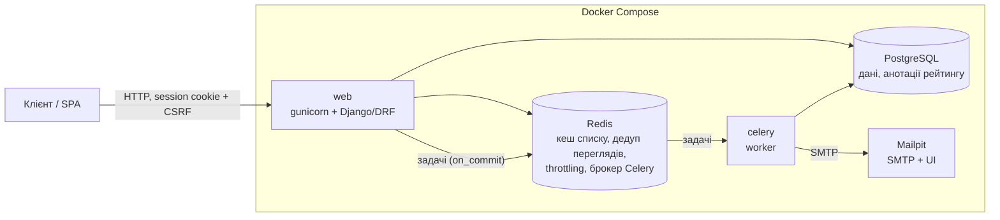
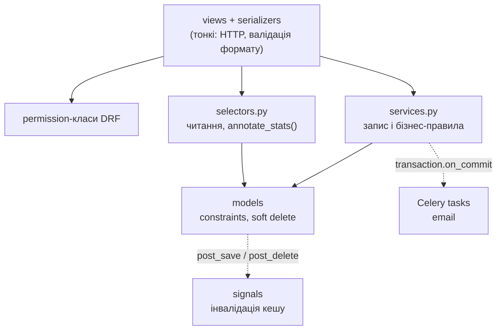

# Мапа популярності локацій

REST API сервісу, де користувачі додають цікаві місця, залишають відгуки з оцінками, голосують
за відгуки й переглядають найпопулярніші локації на мапі. Рейтинг і популярність не зберігаються
в БД — вони обчислюються Django ORM на кожен запит.

**Стек:** Python 3.12, Django 5.2, Django REST Framework, django-filter, PostgreSQL 16, Redis 7,
Celery, pandas, drf-spectacular, gunicorn, Docker Compose. Залежності — `uv` з lock-файлом,
якість — ruff, pytest, factory_boy, freezegun, GitHub Actions.

## Зміст

- [Швидкий старт](#швидкий-старт)
- [Архітектура](#архітектура)
- [API](#api)
- [Рейтинг і популярність](#рейтинг-і-популярність)
- [Перегляди](#перегляди)
- [Кеш списку локацій](#кеш-списку-локацій)
- [Email і фонові задачі](#email-і-фонові-задачі)
- [Тести та якість коду](#тести-та-якість-коду)
- [Конфігурація](#конфігурація)
- [Архітектурні рішення та компроміси](#архітектурні-рішення-та-компроміси)

## Швидкий старт

Потрібні лише Docker і Docker Compose. `.env` створювати не обов'язково: compose читає робочі
значення з `.env.example`, а необов'язковий `.env` їх перевизначає (`make env` створить його).

```bash
make up      # docker compose up -d --build --wait: збірка, міграції, collectstatic, healthchecks
make seed    # демо-дані
```

| Що | Адреса |
|----|--------|
| API | http://localhost:8000/api/v1/ |
| Swagger UI | http://localhost:8000/api/docs/ |
| OpenAPI-схема | http://localhost:8000/api/schema/ |
| Django Admin | http://localhost:8000/admin/ |
| Mailpit (вхідні листи) | http://localhost:8025 |

**Демо-дані** (`make seed`): адміністратор, 8 користувачів, 6 категорій і 30 реальних місць
Києва, Львова й Одеси — з відгуками, реакціями, переглядами за останні два тижні й підписками.
Є локації без відгуків, із поганими відгуками (від'ємна популярність) і дві м'яко видалені
(їх можна відновити в Admin). Дані детерміновані (`--seed`), повторний запуск нічого не дублює,
`seed_demo --reset` перестворює їх. Листів сід не надсилає.

| Акаунт | Email | Пароль |
|--------|-------|--------|
| Адміністратор | `admin@demo.local` | `demo12345` |
| Користувач | `olena@demo.local` (також `taras`, `iryna`, … `@demo.local`) | `demo12345` |

Команда створює суперкористувача, тому при `DEBUG=False` працює лише з `--allow-production` і
власним `--password` (пароль за замовчуванням є в цьому README); власний пароль у вивід не
потрапляє. Якщо `admin` чи інші демо-імена вже зайняті справжніми користувачами, команда
зупиняється з поясненням, нічого не змінивши.

### Команди Makefile

| Команда | Дія |
|---------|-----|
| `make up` / `make down` | запустити (з очікуванням healthchecks) / зупинити |
| `make logs`, `make ps` | логи й стан сервісів |
| `make test` | тести з покриттям |
| `make lint` / `make fmt` | ruff: перевірка / автовиправлення |
| `make migrate`, `make makemigrations` | міграції |
| `make seed` | демо-дані |
| `make shell` | Django shell |

## Архітектура



Шари всередині застосунку:



```
config/              settings/{base,dev,test,prod}.py, urls, celery
apps/users/          User (вхід за email), auth-ендпоінти, скидання пароля
apps/locations/      Category, Location, LocationView; selectors, фільтри, кеш, експорт, seed_demo
apps/reviews/        Review, ReviewReaction
apps/notifications/  LocationSubscription, email-задачі, шаблони листів
common/              базові моделі, permissions, пагінація, обробник помилок, throttles, health
```

- **Запис** — лише через `services.py`, **читання** — через `selectors.py`. Views і serializers
  не містять бізнес-логіки, права перевіряють permission-класи DRF, помилки — це винятки, які
  єдиний exception handler перетворює у стандартну відповідь.
- **Django Admin** — для всіх моделей. Для локацій видно й м'яко видалені записи, є фільтр
  «видалені» та дія «відновити».
- **Health:** `GET /api/v1/health/` перевіряє PostgreSQL і Redis, повертає 200 або 503. Його ж
  використовує healthcheck контейнера.
- **Логи** — у stdout, `LOG_FORMAT=json` для production. Бізнес-події (створення локації й
  відгуку, відправка листів, помилки Redis) логуються з ідентифікаторами.
- **Docker:** multi-stage образ, non-root користувач, gunicorn. Entrypoint чекає БД, виконує
  `migrate` і `collectstatic`. Сервіси мають healthchecks і named volumes.

## API

Усі ендпоінти — під `/api/v1/`. Повний опис зі схемами запитів і відповідей — у Swagger.

| Метод | Шлях | Доступ |
|-------|------|--------|
| GET | `auth/csrf/` | всі — ставить cookie `csrftoken` і повертає токен |
| POST | `auth/register/` | всі — `{email, username, password}` → 201, одразу логінить |
| POST | `auth/login/` | всі — `{email, password}` |
| POST | `auth/logout/` | авторизовані |
| GET | `auth/me/` | авторизовані |
| POST | `auth/password/change/` | авторизовані — `{old_password, new_password}` |
| POST | `auth/password/reset/` | всі — `{email}` → завжди 204 |
| POST | `auth/password/reset/confirm/` | всі — `{uid, token, new_password}` |
| GET, POST, PATCH, PUT, DELETE | `categories/`, `categories/{id}/` | читання — всі, запис — адмін |
| GET, POST, PATCH, PUT, DELETE | `locations/`, `locations/{id}/` | читання — всі, створення — авторизовані, зміна й видалення — автор або адмін |
| GET | `locations/export/?file_format=csv\|json` | всі |
| GET, POST | `locations/{id}/reviews/` | читання — всі, створення — авторизовані |
| PATCH, DELETE | `reviews/{id}/` | автор; видалити може й адмін |
| POST, DELETE | `reviews/{id}/reaction/` | авторизовані — `{value: "like"\|"dislike"}` |
| POST, DELETE | `locations/{id}/subscription/` | авторизовані |
| GET | `me/subscriptions/` | авторизовані |
| GET | `health/` | всі |

### Помилки

Усі помилки, включно з 404, 405, 429 і CSRF, мають один формат:

```json
{"error": {"code": "conflict", "message": "Ви вже залишили відгук до цієї локації.", "details": {}}}
```

| Код | Коли |
|-----|------|
| 400 | помилка валідації (`details` — помилки по полях) або порушення бізнес-правила (відгук на власну локацію, голос за власний відгук) |
| 401 | не автентифікований |
| 403 | немає прав або відсутній CSRF-токен |
| 404 | не знайдено, зокрема м'яко видалена локація |
| 409 | конфлікт стану: повторний відгук, повторний голос, повторна підписка, видалення категорії з локаціями |
| 429 | перевищено ліміт запитів |

### Автентифікація для фронтенду

Лише сесія Django і cookies, без JWT. Сценарій для SPA:

1. `GET auth/csrf/` — ставить cookie `csrftoken` і повертає токен у тілі.
2. Кожен POST/PUT/PATCH/DELETE — з заголовком `X-CSRFToken`, **включно з** login, register і
   password reset. DRF за замовчуванням перевіряє CSRF лише для вже залогінених, тому ці
   ендпоінти захищені явно.
3. Після успішних login і register Django ротує CSRF-токен (захист від session fixation) —
   фронтенд має перечитати `csrftoken` з cookie або повторити `GET auth/csrf/`.

CORS і довірені origin-и задаються через env (`CORS_ALLOWED_ORIGINS`, `CSRF_TRUSTED_ORIGINS`),
credentials дозволені — API готове до SPA на іншому домені.

Email користувача ніколи не потрапляє в публічні відповіді: автор локації чи відгуку
віддається як `{id, username}`. Email бачить лише сам користувач у `auth/me/`.

### Список локацій: пошук, фільтри, сортування, пагінація

| Параметр | Опис |
|----------|------|
| `search` | пошук за назвою й описом (`icontains` по GIN trigram-індексах) |
| `category`, `author` | id категорії / автора; невідомий id дає порожній список, а не 400 |
| `min_rating`, `max_rating` | межі середнього рейтингу; локації без відгуків не повертаються |
| `bbox=min_lng,min_lat,max_lng,max_lat` | видима область мапи; `min_lng > max_lng` — область перетинає антимеридіан 180° |
| `ordering` | `created_at`, `avg_rating`, `popularity`, з `-` для спадання; за замовчуванням `-popularity` |
| `page`, `page_size` | пагінація: 20 за замовчуванням, до 100 |

Сортування стабільне (додатковий ключ `-id`), тож сторінки не перекриваються. Локації без
відгуків при сортуванні за рейтингом завжди в кінці — в обидва боки.

Кожна локація в списку й деталях містить `avg_rating`, `reviews_count`, `views_7d`,
`views_total` і `popularity`.

### Експорт

`GET locations/export/?file_format=csv|json` (за замовчуванням CSV) приймає ті самі фільтри й
сортування, що й список, але без пагінації. Файл формує pandas.

- Поля: локація, категорія (id, назва), автор (id, username), `avg_rating`, `reviews_count`,
  `views_7d`, `popularity`, `created_at`.
- Ім'я файлу з датою: `locations-YYYY-MM-DD.csv|json` (`Content-Disposition: attachment`).
- Ліміт — `EXPORT_MAX_ROWS` (10 000). Заголовок `X-Export-Limit` є завжди; якщо рядків більше,
  віддаються перші N за поточним сортуванням і `X-Export-Truncated: true`.
- CSV — з BOM, щоб Excel правильно показав кирилицю. Значення, що починаються з `= + - @`,
  табуляції чи CR, отримують префікс `'` (захист від formula injection); JSON віддається як є.
- Окремий throttle 10/хв. `Content-Disposition` і `X-Export-*` дозволені в CORS, тож SPA їх бачить.

Параметр називається `file_format`, а не `format`: `format` перехоплює content negotiation DRF.

### Throttling

| Ліміт | За замовчуванням |
|-------|------------------|
| анонім / авторизований | 60/хв / 300/хв |
| login: за IP / за акаунтом (email) | 10/хв / 5/хв |
| register | 5/год |
| password reset / reset confirm | 5/год / 10/год |
| export | 10/хв |

## Рейтинг і популярність

`avg_rating`, `reviews_count`, `views_7d`, `views_total` і `popularity` — не поля моделі, а
анотації однієї функції `selectors.annotate_stats()`, яку використовують список, деталі й
експорт. Перегляди рахуються окремими `Subquery`: JOIN таблиці переглядів поруч із відгуками
множив би рядки й ламав `Avg` і `Count`.

### Формула

```
bayes      = (sum(ratings) + M·C) / (n + M)              M = 5, C = 3.0
quality    = ((bayes − 1) / 4) ^ P                       P = 2, діапазон 0..1
q0         = ((C − 1) / 4) ^ P                           = 0.25, якість «за замовчуванням»
popularity = q0
           + (quality − q0) · (1 + Wr · ln(1 + n))       Wr = 1.5
           + quality · Wv · ln(1 + views_7d)             Wv = 1.0
```

`n` — кількість відгуків, `views_7d` — унікальні перегляди за 7 днів. Усі константи й вікно
переглядів налаштовуються через env `POPULARITY_*`. Реалізація — вирази ORM (`Coalesce`, `Cast`,
`Power`, `Ln`), обчислюється в PostgreSQL.

### Чому саме так

Популярність має означати «багато людей, і їм подобається», а не просто «багато активності».

- **Байєсівське середнє.** До кожної локації додається M віртуальних відгуків з оцінкою C.
  Один відгук «5» не обганяє двадцять відгуків із середнім 4.7.
- **Відгуки підсилюють відхилення від середнього.** Кількість відгуків множить не якість, а
  різницю `quality − q0`. Якщо середня вище C, більше відгуків піднімає локацію; нижче C —
  опускає; рівно C — нічого не змінює. Тому 100 відгуків «1» опиняються нижче за локацію без
  відгуків.
- **Перегляди — окремий невід'ємний доданок.** Більше переглядів ніколи не знижує популярність
  і допомагає навіть локаціям без відгуків. Але він масштабований якістю, тож поганому місцю
  перегляди майже не допомагають.
- **Квадрат у `quality`** розтягує верх шкали: різниця між 4.5 і 5 важить більше, ніж між 1.5 і 2.

Еталонний порядок (без переглядів):

| Локація | popularity |
|---------|-----------:|
| 100 відгуків «1» | ≈ −1.73 |
| без відгуків | 0.25 |
| 1 відгук «5» | ≈ 0.43 |
| 20 відгуків «5» | ≈ 3.37 |

Популярність може бути від'ємною: це лише ключ сортування, абсолютна шкала значення не має.

Розглянуті й відкинуті варіанти:

- *Адитивна формула* `w₁·bayes + w₂·ln(1+n) + …` нагороджувала будь-яку активність: 100
  відгуків «1» були вище за локацію без відгуків.
- *Мультиплікативна* `quality × activity`: перший відгук «1» підвищував популярність, а 1000
  відгуків «2» обганяли один відгук «5», бо активність росте необмежено.

Без відгуків `avg_rating = null`. Фільтри `min_rating`/`max_rating` такі локації не повертають,
а сортування за рейтингом ставить їх у кінець.

## Перегляди

- Кожен `GET locations/{id}/` реєструє перегляд — подію в таблиці `LocationView`.
- Ключ відвідувача: `user:{id}` для авторизованих, `anon:{ip}` для анонімів. IP береться з
  `REMOTE_ADDR`; `X-Forwarded-For` враховується лише за заданої кількості довірених проксі
  (`TRUSTED_PROXY_COUNT`), інакше його легко підробити.
- Один перегляд на відвідувача за годину (`LOCATION_VIEW_DEDUP_TTL`): `cache.add()` у
  django-redis — це атомарний `SET NX EX`, тож із паралельних запитів пройде лише один.
- Автор, відкриваючи власну локацію, лічильник не збільшує.
- Якщо Redis недоступний, перегляд не рахується (без дедуплікації лічильник легко накрутити),
  помилка логується, а деталі все одно повертаються з кодом 200.

## Кеш списку локацій

- Кешується відповідь `GET locations/` з урахуванням фільтрів, сортування й сторінки.
  Вона однакова для всіх користувачів — у ній немає полів, що залежать від `request.user`.
- **Ключ:** `locations:list:v{version}:{sha1(параметрів)}`. У хеш потрапляють лише відомі
  параметри, відсортовані за назвою: `?b=2&a=1` і `?a=1&b=2` дають один ключ, а сторонні
  параметри не плодять записів. TTL — `LOCATIONS_LIST_CACHE_TTL` (5 хв).
- **Інвалідація** — інкремент версії, а не пошук і видалення ключів: старі записи стають
  недосяжними й зникають за TTL. Це O(1) і не потребує `KEYS`/`SCAN`.
- **Тригери** — сигнали `post_save`/`post_delete` для Location, Review і Category, тож кеш
  скидається за будь-якої зміни: через API, Django Admin чи ORM (soft delete теж іде через
  `save()`). Зміна username автора теж скидає кеш, а інші зміни User (наприклад, `last_login`
  при вході) — ні. `QuerySet.update()` і `bulk_*` сигналів не надсилають, тому для цих моделей
  не використовуються.
- **Гонка з транзакцією:** версія інкрементується одразу й ще раз після коміту. Інакше
  паралельний запит між зміною й комітом прочитав би старі дані й закешував їх під новою версією.
- **Пагінація:** сторінка лежить у кеші без `next`/`previous`. Ці посилання абсолютні (host,
  усі параметри запиту), тож будуються для кожного запиту окремо.
- **Відмовостійкість:** `IGNORE_EXCEPTIONS` плюс власна обробка помилок — якщо Redis
  недоступний, запит просто йде в БД.

## Email і фонові задачі

- Усі листи надсилає Celery worker (брокер — Redis). Задачі ставляться через
  `transaction.on_commit`, тож worker гарантовано бачить закомічені дані, а відкат транзакції
  не залишає «фантомних» листів.
- Повтори при збоях SMTP: до `EMAIL_TASK_MAX_RETRIES` (3) з експоненційною затримкою.
- **Скидання пароля:** лист із посиланням `{FRONTEND_URL}/reset-password?uid=…&token=…`;
  токен — стандартний `PasswordResetTokenGenerator`.
- **Новий відгук:** лист автору локації та всім підписникам. Автор відгуку листа не отримує,
  кожен отримувач — рівно один лист, навіть якщо він і автор локації, і підписник. Позначка
  «вже надіслано» в Redis робить задачу ідемпотентною при повторній доставці.
- Шаблони листів — текстовий і HTML-варіант.
- Локально всі листи потрапляють у Mailpit: http://localhost:8025.

## Тести та якість коду

```bash
make test                                                                  # усі тести з покриттям
docker compose exec web pytest apps/reviews/tests/test_reviews_api.py -q   # один файл
make lint                                                                  # ruff check + format --check
```

- pytest + pytest-django, дані — factory_boy, час — freezegun. Тести переважно API-рівня:
  права доступу, формат помилок, CSRF, throttling, кеш, відсутність N+1
  (`django_assert_num_queries`), відмова Redis, черга листів.
- Тести йдуть на справжніх PostgreSQL і Redis (окрема БД Redis), як і production.
- Покриття ≥ 85% — поріг перевіряється в CI.
- **CI** (GitHub Actions): ruff, перевірка compose-конфігурації, `makemigrations --check` і
  pytest з сервісами PostgreSQL і Redis.
- pre-commit запускає ruff перед кожним комітом.

## Конфігурація

Усі налаштування — зі змінних оточення (12-factor). Повний перелік із коментарями — у
`.env.example`: БД, Redis, Celery, SMTP, CORS/CSRF, довірені проксі, пагінація, коефіцієнти
популярності, TTL кешу й дедуплікації, ліміт експорту, throttles, логування, gunicorn.

Модулі налаштувань: `config.settings.dev` (за замовчуванням у compose), `config.settings.prod`,
`config.settings.test`. У `prod.py`: `DEBUG=False`, `ALLOWED_HOSTS` з env, secure і HttpOnly
cookies, `SameSite=Lax`, HSTS, `SECURE_PROXY_SSL_HEADER`; застосунок не стартує зі стандартним
`DJANGO_SECRET_KEY`.

## Архітектурні рішення та компроміси

**Дані й ORM**

- **Нічого обчислюваного не зберігається.** Рейтинг, популярність і лічильники переглядів —
  анотації. Плата — агрегація на кожен запит; її компенсують індекси, `Subquery` для переглядів
  і кеш списку. Денормалізовані лічильники стали б наступним кроком лише за реального навантаження.
- **Soft delete локацій.** Видалена локація зникає зі списку, деталей і експорту, а нові
  відгуки, реакції й підписки до неї дають 404. Рядок і відгуки лишаються в БД, адмін може
  відновити локацію. `on_delete=PROTECT` на категорії враховує й видалені локації, тому категорію
  з ними видалити не можна (409).
- **Цілісність на рівні БД.** Унікальність відгуку, реакції й підписки та діапазони рейтингу й
  координат — це `UniqueConstraint`/`CheckConstraint`, а не лише валідація. Гонка двох однакових
  запитів дає 409, а не 500.
- **Пошук** — `icontains` по GIN trigram-індексах на `UPPER(name)` і `UPPER(description)`:
  саме в такий вираз Django компілює `icontains` для PostgreSQL.

**Коди відповідей**

- 409 для конфлікту стану (ресурс уже існує або на нього посилаються), 400 для порушення
  бізнес-правила, яке не залежить від стану (відгук на власну локацію).
- **Повторний голос.** Голос один на користувача: повторний POST дає 409. Щоб змінити голос,
  його треба зняти (`DELETE`) і поставити знову. Так кожна дія явна, а «один голос» гарантує
  constraint у БД.

**Безпека й авторизація**

- **Вхід за email**, `username` — публічне ім'я. Email унікальний без урахування регістру.
  Підтвердження email при реєстрації немає — це точка розширення (той самий механізм токенів,
  що й у скиданні пароля).
- **Реєстрація розкриває, чи зайнятий email** (400 з помилкою по полю): без цього користувач не
  зрозуміє, чому не може створити акаунт. Ризик пом'якшено лімітом 5 реєстрацій на годину з IP.
  Скидання пароля, навпаки, завжди відповідає 204, а login дає однакову помилку для неіснуючого
  email і неправильного пароля.
- **Ліміт входу за акаунтом** (5/хв за SHA-256 нормалізованого email) захищає від перебору
  пароля з багатьох IP. Зворотний бік — зловмисник може на хвилину заблокувати вхід у чужий
  акаунт. Для такого масштабу це прийнятно; у production можна додати CAPTCHA після N невдач.
- **Скидання пароля відповідає 204, навіть якщо брокер Celery недоступний:** помилка постановки
  задачі лише логується. Лишається слабкий часовий канал — для відомого email запит трохи
  довший через публікацію задачі. Повністю його закрила б постановка задачі для будь-якого
  email із перевіркою вже у worker'і; для цього проєкту це зайве.

**Кеш і перегляди**

- **Перегляди не скидають кеш списку** — інакше кожне відкриття деталей обнуляло б його.
  Тому `views_7d` і `popularity` у списку можуть відставати максимум на TTL (5 хв).
  Деталі локації не кешуються й завжди актуальні.
- **Redis — не єдина точка відмови.** Без нього сервіс працює: список іде в БД, перегляди не
  рахуються, деталі віддаються. Health при цьому повертає 503, щоб балансувальник знав про
  деградацію.
- **Перегляди — журнал подій**, а не лічильник: так можна рахувати будь-яке вікно (`views_7d`,
  `views_total`) без додаткових полів. За великих обсягів старі події варто агрегувати чи
  партиціювати таблицю.
